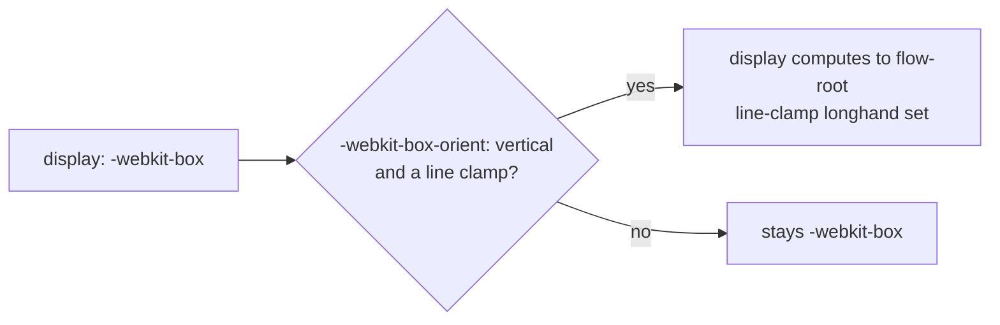

> One change of the stylo fork, review ref `review/03`, 3 of 3 in the stack.
> Below it: `review/02`.
> The pull request opens from the commit under this README commit; the README is not part of it.
> The stack, the glossary and how to build are in the [overview README](https://github.com/Airodonack/stylo/blob/vodscribe/main/README.md).

# 03. -webkit-line-clamp

**What a page gets.**
Text clamped with `display: -webkit-box; -webkit-box-orient: vertical; -webkit-line-clamp: N` shows only its first N lines.
Before, Servo dropped all three declarations and the text kept every line.

**Why upstream wants it.**
Many sites clamp titles this way.
Stylo has it all for Gecko; this commit only lifts the Gecko-only gates.

**What changes in stylo.**

- `style/properties/shorthands.toml`: `-webkit-line-clamp` is built for Servo.
  It sets the `line-clamp` longhand even while that longhand's preference, `layout.css.line-clamp.enabled`, is off, as in Gecko.
  So the unprefixed `line-clamp` stays hidden from pages, as in Chrome.
- `style/properties/longhands.toml`: `-moz-box-orient` and its alias `-webkit-box-orient` are built for Servo.
  They live in the XUL style struct, so Servo's `ComputedValues` grows from 232 to 240 bytes; the size test in `style/properties/properties.mako.rs` says so.
- `style/values/specified/box.rs`: `display: -webkit-box`, `-webkit-inline-box` and `flow-root` exist for Servo.
- `style/style_adjuster.rs`: a clamped vertical `-webkit-box` computes to `flow-root`, and a `-webkit-inline-box` to `inline-block`.
  The original display is kept so layout can tell the legacy case apart.

**What the Servo side needs.**
The Servo fork's layout counts line boxes in the clamped box and drops what comes after the Nth line.
It puts an ellipsis at the end of that line and sizes the box to the lines it keeps.
An unclamped `-webkit-box` is laid out as a flex container.

**Spec.**
[CSS Overflow 4, legacy compatibility](https://drafts.csswg.org/css-overflow-4/#webkit-line-clamp): "UAs that support line-clamp must also support the -webkit-line-clamp property".
[CSS Overflow 4, continue](https://drafts.csswg.org/css-overflow-4/#continue): with the clamp, "If the specified value of the display property is -webkit-box, the computed value becomes flow-root".

**Checked.**
A test page gives the same height, `display` and `-webkit-line-clamp` values as Chrome 156.
`CSS.supports` is true for `display: -webkit-box` and `-webkit-line-clamp`, and false for `line-clamp`, as in Chrome.
In WPT `css/css-overflow/line-clamp` and the parsing tests, 17 subtests go from FAIL to PASS.
`cargo check -p stylo` with the `servo` feature builds.
