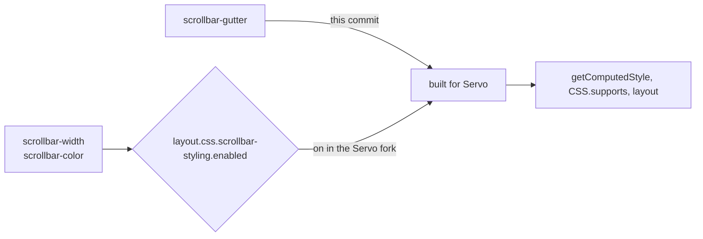

> One change of the stylo fork, review ref `review/02`, 2 of 3 in the stack.
> Below it: `review/01`. Above it: `review/03`.
> The pull request opens from the commit under this README commit; the README is not part of it.
> The stack, the glossary and how to build are in the [overview README](https://github.com/Airodonack/stylo/blob/vodscribe/main/README.md).

# 02. scrollbar-gutter

**What a page gets.**
With the Servo fork, pages can set `scrollbar-width`, `scrollbar-color` and `scrollbar-gutter`.
`getComputedStyle` reports them and `CSS.supports` answers true.

**Why upstream wants it.**
Stylo parses and computes all three already.
`scrollbar-gutter` was built for Gecko only, so Servo's layout could not reserve room for a scrollbar.

**What changes in stylo.**
One line in `style/properties/longhands.toml`: `scrollbar-gutter` is built for Servo too.
`scrollbar-width` and `scrollbar-color` need no change here.

**What the Servo side needs.**
On stylo `main`, `scrollbar-width` and `scrollbar-color` sit behind the preference `layout.css.scrollbar-styling.enabled`, off by default.
The Servo fork turns it on in `components/config/prefs.rs`.
Servo's DOM bindings take the property list from stylo's generated `css-properties.json`, so nothing else is needed for the CSSOM.

**Spec.**
[CSS Overflow 3, scrollbar-gutter](https://drafts.csswg.org/css-overflow-3/#scrollbar-gutter-property) and [CSS Scrollbars 1](https://drafts.csswg.org/css-scrollbars-1/).

**Checked.**
WPT `css/css-scrollbars` and `css/css-overflow` with the Servo fork.
A test page returns the same computed values as headless Chrome.
