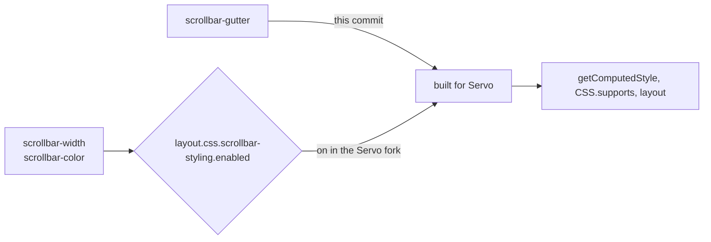
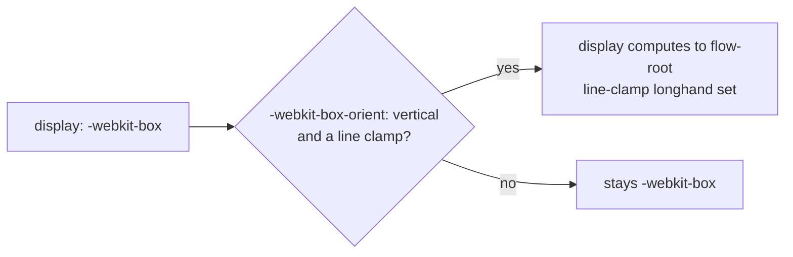

# Stylo for VODscribe

This is a fork of [Stylo](https://github.com/servo/stylo), the CSS engine of Servo and Firefox.
The [Servo fork](https://github.com/Airodonack/servo) that runs the VODscribe desktop app builds against it.
It tracks stylo `main` and adds three commits, each meant for upstream.
This README is one more commit on top of them, so it never reaches upstream.

Servo takes stylo by git revision, so the Servo fork pins this one the same way.
Its `Cargo.toml` patches all eleven crates of this workspace together, or Cargo builds two copies of the shared ones:

```toml
[patch."https://github.com/servo/stylo"]
stylo = { git = "https://github.com/Airodonack/stylo", rev = "<commit below this README>" }
selectors = { git = "https://github.com/Airodonack/stylo", rev = "<same commit>" }
# ...and servo_arc, stylo_atoms, stylo_derive, stylo_dom, stylo_malloc_size_of,
# stylo_static_prefs, stylo_traits, to_shmem, to_shmem_derive
```

## The stack

On stylo `main`, oldest first:

1. Servo pages can use accent-color, and UA sheets can paint with it
2. Servo pages can use scrollbar-gutter
3. Servo pages can use -webkit-line-clamp and display: -webkit-box
4. This README

The branch is rebased onto stylo `main` as upstream moves.

## 1. accent-color

**What a page gets.**
`accent-color` works in Servo.
The checked radio button, the checkbox check, and the filled part and thumb of a slider take its colour.
With `auto` the controls keep their usual colours.

**Why upstream wants it.**
Stylo already parses and computes `accent-color`, but only for Gecko.
Servo draws form controls with user agent CSS, and that CSS had no way to read the property.

**What changes in stylo.**

- `style/properties/longhands.toml`: `accent-color` is built for Servo and restyles with a repaint.
- `style/values/specified/color.rs`: a new colour keyword, `-servo-accent-color`, computes to the parent's `accent-color`, or to `currentcolor` when that is `auto`.
  It parses only in user agent and chrome sheets, so pages cannot use it.
  A translucent accent is laid over the canvas colour of the used colour scheme, as the WPT tests expect.
- `style/device/servo.rs`: the keyword falls back to the same system colour as `AccentColor`.

**What the Servo side needs.**
`servo.css` sets the old colour as `color` on each control part and `-servo-accent-color` as its fill.
Disabled controls stay grey.

**Spec.**
[CSS UI 4, accent-color](https://drafts.csswg.org/css-ui-4/#widget-accent): it "allows the author to specify the accent color for user-interface controls generated by the element".

**Checked.**
WPT `css/css-ui` accent-color tests, and a test page compared pixel by pixel with headless Chrome.
`CSS.supports("color", "-servo-accent-color")` is false for pages.

## 2. scrollbar-gutter

**What a page gets.**
With the Servo fork, pages can set `scrollbar-width`, `scrollbar-color` and `scrollbar-gutter`.
`getComputedStyle` reports them and `CSS.supports` answers true.

**Why upstream wants it.**
Stylo parses and computes all three already.
`scrollbar-gutter` was built for Gecko only, so Servo's layout could not reserve room for a scrollbar.

**What changes in stylo.**
One line in `style/properties/longhands.toml`: `scrollbar-gutter` is built for Servo too.
`scrollbar-width` and `scrollbar-color` need no change here.

**What the Servo side needs.**
On stylo `main`, `scrollbar-width` and `scrollbar-color` sit behind the preference `layout.css.scrollbar-styling.enabled`, off by default.
The Servo fork turns it on in `components/config/prefs.rs`.
Servo's DOM bindings take the property list from stylo's generated `css-properties.json`, so nothing else is needed for the CSSOM.



**Spec.**
[CSS Overflow 3, scrollbar-gutter](https://drafts.csswg.org/css-overflow-3/#scrollbar-gutter-property) and [CSS Scrollbars 1](https://drafts.csswg.org/css-scrollbars-1/).

**Checked.**
WPT `css/css-scrollbars` and `css/css-overflow` with the Servo fork.
A test page returns the same computed values as headless Chrome.

## 3. -webkit-line-clamp

**What a page gets.**
Text clamped with `display: -webkit-box; -webkit-box-orient: vertical; -webkit-line-clamp: N` shows only its first N lines.
Before, Servo dropped all three declarations and the text kept every line.

**Why upstream wants it.**
Many sites clamp titles this way.
Stylo has it all for Gecko; this commit only lifts the Gecko-only gates.

**What changes in stylo.**

- `style/properties/shorthands.toml`: `-webkit-line-clamp` is built for Servo.
  It sets the `line-clamp` longhand even while that longhand's preference, `layout.css.line-clamp.enabled`, is off, as in Gecko.
  So the unprefixed `line-clamp` stays hidden from pages, as in Chrome.
- `style/properties/longhands.toml`: `-moz-box-orient` and its alias `-webkit-box-orient` are built for Servo.
  They live in the XUL style struct, so Servo's `ComputedValues` grows from 232 to 240 bytes; the size test in `style/properties/properties.mako.rs` says so.
- `style/values/specified/box.rs`: `display: -webkit-box`, `-webkit-inline-box` and `flow-root` exist for Servo.
- `style/style_adjuster.rs`: a clamped vertical `-webkit-box` computes to `flow-root`, and a `-webkit-inline-box` to `inline-block`.
  The original display is kept so layout can tell the legacy case apart.



**What the Servo side needs.**
The Servo fork's layout counts line boxes in the clamped box and drops what comes after the Nth line.
It puts an ellipsis at the end of that line and sizes the box to the lines it keeps.
An unclamped `-webkit-box` is laid out as a flex container.

**Spec.**
[CSS Overflow 4, legacy compatibility](https://drafts.csswg.org/css-overflow-4/#webkit-line-clamp): "UAs that support line-clamp must also support the -webkit-line-clamp property".
[CSS Overflow 4, continue](https://drafts.csswg.org/css-overflow-4/#continue): with the clamp, "If the specified value of the display property is -webkit-box, the computed value becomes flow-root".

**Checked.**
A test page gives the same height, `display` and `-webkit-line-clamp` values as Chrome 156.
`CSS.supports` is true for `display: -webkit-box` and `-webkit-line-clamp`, and false for `line-clamp`, as in Chrome.
In WPT `css/css-overflow/line-clamp` and the parsing tests, 17 subtests go from FAIL to PASS.
`cargo check -p stylo` with the `servo` feature builds.

## Not done

- The unprefixed `line-clamp` stays behind its preference; Chrome does not ship it either.
- `-moz-box-orient` is exposed next to `-webkit-box-orient`; Chrome has only the latter.
- The legacy box's own `-webkit-box-align`, `-webkit-box-pack` and `-webkit-box-flex` are not done for Servo.

## License

MPL 2.0, as upstream Stylo.
